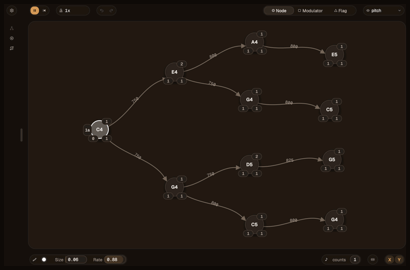

<div align="center">

# SequenceTree

**Draw a graph. Hear a sequence.**

A polyphonic, generative MIDI sequencer. You draw trees of notes, and traversals walk them: counting their visits, branching, looping, spawning one another, and playing many voices at once.


[](https://github.com/EliBaumgardner/SequenceTree/actions/workflows/tests.yml)



[Getting started](#getting-started) · [How a traversal unfolds](#how-a-traversal-unfolds) · [Drawing](#drawing-a-graph) · [Node types](#node-types) · [Node values](#node-values) · [Polyphony](#polyphony) · [Ornaments](#ornaments) · [Building](#building) · [Scripting guide](documentation/ScriptingLanguage.md) · [Architecture](documentation/Architecture.md)

</div>

---

## What it is

A music sequencer is a device which generates and modifies a musical pattern (sequence) over time. SequenceTree displays musical information on an editable graph which allows the user to create complex sequences.

## Getting started

1. **Connect it to a sound.**
   - **Standalone app:** open **Options → Audio/MIDI Settings** and choose a **MIDI Output**: a hardware synth, or a virtual port (on macOS, enable the IAC Driver in Audio MIDI Setup) that a software synth or DAW listens to.
   - **Plugin:** add SequenceTree to an instrument track, then route that track's MIDI output to the track holding your synth. How you route it depends on your DAW; see [Limitations](#limitations).
2. **Shift-click** the empty canvas to place a root node. It already has a note.
3. **Shift-drag** from the root to drag out a child. The length of the arrow is how long the root's note lasts.
4. Press **Space** (or the play button) to start. In a DAW, SequenceTree follows the host's transport instead.
5. Add a few more children with different **count limits**, and listen to the route change from pass to pass.

## How a traversal unfolds

A **traversal** is one voice moving through a tree. It plays a node, waits for the note to end, chooses the next node, and plays that.

1. **It starts at a root** and follows arrows downward, playing each node it lands on.
2. **The arrow's length is the note's length.** The note a node plays lasts as long as the arrow leaving it toward the next node, so the shape of the graph is its rhythm. Drag a node and the music retimes as you drag.
3. **Each node counts how many times it has been left**, and its children's **count limits** decide where it goes. A child with count limit *N* is a candidate every *N*th time, and the candidate with the highest limit wins.
4. **When it runs out of places to go, it returns to the root** and starts the next pass. The counts are kept, so the next pass takes a different route.
5. **It keeps looping** until the root's loop limit is reached (0 means forever).

For example, a root R leads to A, and A has three children: B (count limit 1), C (2) and D (4). Each pass ends at a leaf and goes back to R:

```
pass 1   R A B        A left 1 time:  only B qualifies
pass 2   R A C        A left 2 times: B and C qualify, C has the higher limit
pass 3   R A B
pass 4   R A D        A left 4 times: B, C and D qualify, D wins
...      the cycle repeats every 4 passes
```

Nest that pattern a few levels deep, with different limits at each level, and the cycles multiply into long phrases that evolve rather than loop.

## Drawing a graph

What Shift-drag creates is set by the mode buttons in the title bar: **Node**, **Modulator** or **Traversal flag**. With no mode selected, the canvas is in **arrow mode**.

| Gesture | Does |
|---|---|
| Shift-click empty canvas | Place a root node |
| Shift-drag from a node | Drag out a child of the current mode. In arrow mode, draw a dangling arrow instead |
| Ctrl+Shift-drag from a node | Drag out an [alternative](#note-nodes) |
| Drag a node | Move it and its descendants (snaps to the grid) |
| Drag an arrow head | Move the node it points to |
| Click an arrow's length label | Type an exact length |
| Ctrl-drag on a node's value | Scrub the value up or down |
| Right-click an arrow | Arrow menu: allowed traversals, traversal arrow, sync |
| Right-click the canvas | Copy, paste, delete |
| Shift+right-click | Delete the node or arrow under the cursor |
| Shift-drag the canvas (arrow mode) | Box-select nodes |
| Drag the empty canvas · Shift+scroll or pinch | Pan · zoom |
| Space · ⌘Z / ⇧⌘Z · ⌘C / ⌘V · ⌘A · Delete | Play/pause · undo/redo · copy/paste · select all · delete selection |

## Node types

### Note nodes

The notes themselves. A **root** starts a tree and carries the traversal that plays it, its loop limit and its tempo multiplier. Every **child** holds a pitch, velocity and MIDI channel, and new children inherit their parent's notes and limits so a branch can be sketched quickly.

**Alternative nodes** are variations on a note, hung off it with Ctrl+Shift-drag. Each time the walk lands on the node, its alternatives are chosen by count limit exactly as children are, and the chosen one replaces the node's pitch, velocity, length and repeat for that visit. When none qualifies, the node plays itself. Alternatives can have alternatives of their own, so a single position in the tree can cycle through a set of voicings.

### Modulators

A **modulator** is a small tree hung off a note node that changes how that note plays. It has a traversal of its own that walks the modulator tree with the same counting rules, one step for each note played under its host. Each modulator node shifts the host's pitch by its offset and scales its length by its arrow (an arrow of one second leaves the length unchanged). Because the modulator walk has its own counts, the same melody comes back transposed and stretched differently on each pass. Unsync a modulator's arrow and it steps once per visit to the host instead.

### Traversal flags

A **traversal flag** starts or stops a voice. Hang a flag off a note node, then Shift-drag from the flag onto the node where the new voice should start, and type which traversal it controls: `+2` starts traversal 2 there, `-2` stops it. The flag fires every *N*th time its host is played (its count limit), and the length of the arrow to the flag is how long it waits before firing. Flags are how one melody calls in a bass line every eighth bar, or how a voice ends itself after a set number of passes.

## Node values

Every value below is edited on the node itself or in the node menu.

| Value | What it does |
|---|---|
| **Count limit** | How often this node is chosen. With limit *N* it becomes a candidate every *N*th time its parent is left; the highest limit among the candidates wins. Modulators, flags and alternatives use it the same way. |
| **Trigger limit** | The second number in the count editor. The node can be chosen at most this many times, then it is skipped. 0 means no limit. |
| **Switch count** | Once chosen, the parent keeps choosing this node for this many visits in a row before it counts again. A switch count of 3 on C in the example above turns pass 2 into three passes of R A C. |
| **Sub-loop count** | Turns the node into a loop point. After the walk enters it, reaching the end of the branch returns the walk here instead of to the root, this many times, before it goes back to the root. 1 (the default) means no sub-loop; 0 loops the branch forever. |
| **Loop limit** (roots) | How many passes the tree plays before its traversal stops. 0 loops forever. |
| **Repeat** | Plays the note this many times in a row before moving on. |
| **Probability** | Weights the choice when several candidates share the same count limit. If the weights add up to less than 100%, the rest is the chance that the walk stops here and returns to the root. |
| **Pitch, velocity, channel** | The MIDI note the node sends. |

Arrows carry values too:

- **Length** is the note's duration.
- **Disabled traversals.** An arrow can be switched off for particular traversals, so two voices walking the same tree take different routes through it.
- **Dangling arrows**, drawn from a node into empty space, give a leaf node its length. They have count limits, so a leaf can be short on most passes and long on every fourth.

## Polyphony

SequenceTree plays many voices at once, in several ways that combine freely.

- **Chords.** Place a child directly below its parent and it sounds together with the parent instead of after it. Chord notes keep their count limits, so a voice can join the chord only every *N*th time.
- **Many trees.** Every root on the canvas runs its own traversal at the same time, each with its own rhythm and cycle lengths.
- **Traversals are voices with their own settings.** Each traversal has a colour on the canvas, a MIDI channel, a transpose, a velocity scale and a tempo multiplier. Send traversal 1 to a piano on channel 1 and traversal 2 to a bass on channel 2, an octave down and at half speed, through the same tree.
- **Flags add and remove voices** while the music plays (see [Traversal flags](#traversal-flags)).
- **Trees connect to each other** in three ways:
  - A **cross root tree connection** (drag a node onto another root) starts that tree's own traversal every *N*th time it is reached, while the current voice carries on.
  - A **regular connection** steps into the other tree, walks it, and returns home. The other root's loop limit sets how many times it loops there first.
  - A **traversal arrow** moves the voice onto the other tree for good.

## Ornaments

An **ornament** is a short figure, such as a turn, a trill or a run of grace notes, that a node plays in place of its single note.

- **Build one.** Right-click the **Ornaments** button in the bottom bar to open the ornament window. An ornament is a chain of notes, each set a number of semitones above or below the node's pitch, with its own velocity. The arrows between them share out the node's note length. One note in the chain is the **host**: the node's own note.
- **Name it with a symbol.** Draw a symbol with the pencil, then **Publish** the ornament. Only a published ornament can be played. Later edits stay pending until you publish again, and nodes keep playing the last published version meanwhile.
- **Apply it.** Click the **Ornaments** button to turn on the apply tool, then click nodes. Each one shows the symbol and plays the figure on every visit. Right-click a mark to remove it.
- **Share it.** Libraries are saved as folders in `~/Music/SequenceTree/Ornament Libraries`, one file per ornament. Every open copy of SequenceTree sees the same libraries, and **Add library…** brings in a folder from elsewhere.

## Editing and playback

- **Pitch-bound arrows.** Bind arrows to the X or Y axis (bottom bar), and moving a node transposes it, keeping whatever pitch you last typed as the reference.
- **Paint mode.** Paint pitch or velocity across the canvas with a brush, and the nodes under it take on the painted values.
- **Preview.** The **Note** tool in the bottom bar auditions the sequence from any node you click, optionally on repeat.
- **Groups.** The **Node Span** tool gathers nodes into a group that collapses to one node and loops as a unit. Right-click a group to expand or collapse it, and dissolve it when you need the parts again.
- **Scripting.** Replace the built-in choosing rules with your own: a short script decides which child comes next and what each step plays. Errors are marked on the line as you type, and the last working version keeps playing. See the [scripting guide](documentation/ScriptingLanguage.md).
- **Patches.** A whole graph is saved as a `.sqtree` patch in `~/Music/SequenceTree/Patches`. Open one from the title bar. **Reset** clears the canvas, and first asks whether to save the current patch. Inside a DAW, the graph is also saved with the project.
- **DAW sync.** In a DAW the plugin follows play, stop and tempo. With **Sync to host playhead** on (the default), jumping anywhere in the song lands the graph in exactly the state it would have reached by playing there, counts and all. Turn it off and the graph ignores jumps and carries on from where it is.

## What's under the hood

### Real Time Safe Audio

Audio software has a strict deadline. Every few milliseconds the computer asks the plugin for the next slice of sound. If the plugin is even slightly late, the listener hears a click or a dropout.

The usual cause of lateness is waiting: on memory being handed out, or on another part of the program to finish. **SequenceTree's audio code never waits.**

- **It never asks for memory while playing.** Everything it needs, including room for every voice that can run at once, is set aside before playback starts.
- **The editor never blocks the music.** Editing builds a complete new copy of the graph off to the side, then swaps it in all at once. The music always reads either the old graph or the new one, never a half-edited mix. Old copies are cleaned up only once the audio is certainly finished with them.
- **The audio side never waits for the screen.** It drops messages for the display ("light up this node") into a mailbox the screen picks up once per frame. If the window is closed, the music carries on as normal.
- **This is tested, not just intended.** A dedicated test build uses a checker that crashes the program the instant the audio code reaches for memory, waits on another part of the program, or makes any other call that could be slow. That test plays a graph while it is edited, retimed, rewound and stopped.

### A programming language built in

The scripting feature is a small language written from scratch. The script is read, checked and translated into compact instructions for a tiny virtual machine, and that machine runs the script during playback. The translating happens off the audio path, so only the finished instructions ever reach it.

User code can't be allowed to freeze the music, so every script runs with a **fixed step allowance**. A script stuck in an endless loop is cut off and playback continues. A script with errors never goes live, and the last version that worked keeps playing.

### One set of rules for every traversal

Note traversals, modulators, alternatives and trees that are stepped into all move by **the same code path**: the same counting, switch counts, sub-loops and trigger limits. A rule written once behaves the same everywhere. The test suite checks this by building the same shape as a note tree and as a modulator tree and confirming both play the identical sequence.

### Tested

About 120 automated tests ([Catch2](https://github.com/catchorg/Catch2)) cover how traversals move through a graph, the script language, how a graph's shape becomes timing and pitch, and ornaments. The core that walks the graph is independent of the plugin framework, so its tests build in seconds.

The [architecture guide](documentation/Architecture.md) covers the code itself: the threads, how an edit reaches the audio, how the source is laid out, and what each test covers.

## Building

**Requirements:** macOS with the Xcode command line tools (`xcode-select --install`), CMake 3.22+, and Git. Windows and Linux are untested (see [Limitations](#limitations)).

```bash
git clone https://github.com/EliBaumgardner/SequenceTree.git
cd SequenceTree
git submodule update --init   # fetches JUCE, Catch2 and ArsNovaUI

cmake -B build -DCMAKE_BUILD_TYPE=Release
cmake --build build
```

Don't add `--recursive`: ArsNovaUI's own JUCE submodule is only used by its gallery app.

The first build compiles all of JUCE and takes several minutes; later builds only recompile what changed.

**Running it.** The standalone app is built to `build/SequenceTree_artefacts/Release/Standalone/SequenceTree.app`:

```bash
open build/SequenceTree_artefacts/Release/Standalone/SequenceTree.app
```

Then follow [Getting started](#getting-started) to give it a MIDI output. The same build also copies the AU to `~/Library/Audio/Plug-Ins/Components` and the VST3 to `~/Library/Audio/Plug-Ins/VST3`, so a DAW finds them after a rescan. That overwrites any copy of SequenceTree already installed there.

**Running the tests:**

```bash
cmake --build build --target SequenceTree_Tests SequenceTree_GraphTests
cd build && ctest --output-on-failure
```

## Limitations

- Developed and tested on macOS. JUCE supports Windows and Linux, but neither build has been tried.
- A plugin that only sends MIDI depends on the DAW to route it, and not every host does this the same way. Routing into another track has not yet been confirmed in every DAW.
- SequenceTree controls notes only: no MIDI CC, pitch bend or automation output.

## License

SequenceTree's own source is MIT licensed. See [LICENSE](LICENSE).

It is built on [JUCE](https://juce.com), which is separately licensed under AGPLv3 or a JUCE commercial license. Using and distributing the built plugin is subject to those terms.
