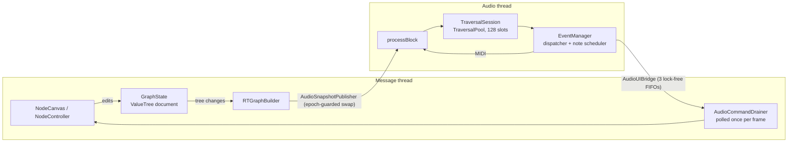

# SequenceTree architecture

This is the technical companion to the [README](../README.md). It describes how the code is organised: the model behind the graph, the threads, how an edit reaches the audio, the scripting language's pipeline, and what the tests cover.

## The model in five ideas

1. **Every walk is the same traversal.** A note traversal, a modulator walk, an alternative being chosen, and a tree being stepped into all use one mechanic:
   - A node's count goes up each time the walk leaves it.
   - Children are chosen by their count limits.
   - Switch counts, sub-loops and trigger limits apply the same way everywhere.

   The walks differ only in what makes them take a step. A note traversal steps when its own note ends. A modulator walk steps once for each note played under its host. Each walk keeps its counts in its own slot. A behaviour that works in one walk and not another is treated as a bug.
2. **Arrow geometry is data.** A note's duration is computed from the vector between two node centres (`RTGraphBuilder::fillDurationMap`). Moving a node retimes the music, which is why a move rebuilds the durations.
3. **Duration is derived; pitch is owned.** Duration is recomputed from the geometry every time. Pitch is stored. A pitch-bound arrow only *shifts* the pitch of the node it points at, and it records how much it has shifted it (`ArrowPitchOffset`). Moving a node therefore transposes it around whatever pitch the user last typed. No arrow ever recalculates a node's pitch from scratch.
4. **The standalone runs its own transport; the plugin follows the host's.** In a DAW, the host's play state and position drive playback.
   - When the host jumps to a new position, `TraversalSession` restarts the walk from the first root.
   - It then silently runs the walk forward to the new position, a bounded slice of time per block. A far jump catches up over several blocks.
   - The graph lands in the state it would have reached by playing there. Positions are compared in beats, so this holds at any tempo.
5. **It is an instrument that only sends MIDI.** The plugin declares itself a synth, so hosts give it a MIDI track. Its audio buffer is always cleared, and every block's MIDI output is generated fresh.

## Threads and data flow



- **Graph → audio.**
  - The graph lives in a `juce::ValueTree`, edited through `GraphState`.
  - `RTGraphBuilder` listens to that tree. It rebuilds the plain-data copy the audio thread reads (`RTData.h`: `RTNode`, `NodeMap`) and hands it to `AudioSnapshotPublisher`.
  - The publisher swaps in a whole new `Snapshot`. The audio thread holds an epoch counter odd while a block runs, so the publisher knows when an old snapshot can be freed safely. The audio thread never frees anything.
- **Audio → screen.**
  - The audio thread writes plain command structs into three FIFOs (highlights, arrows, counts). It never posts a message or wakes the UI.
  - The editor polls those FIFOs once per display frame through a `VBlankAttachment`.
  - With no editor open the FIFOs simply overflow, and the canvas resynchronises on its next drain.
- **Real-time rules.**
  - Nothing on the audio thread allocates, frees, locks or waits.
  - Traversals come from a pool allocated in `prepare`. Per-traversal node state (`NodeStateTable`) is a flat preallocated table, and per-block scratch space lives in reserved member vectors.
  - A RealtimeSanitizer test build enforces all of this (see [Tests](#tests)).

## The scripting language

A traversal script compiles in one pass on the message thread: `ScriptLexer` (text → tokens) → `ScriptParser` (tokens → syntax tree) → `ScriptEmitter` (syntax tree → bytecode). Only the bytecode, an `RTScript`, ever reaches the audio thread.

There it runs on a small stack machine with fixed limits: 32 locals, a 64-slot stack, and a budget of 8,192 steps per call. The step budget is what stops a user's endless loop from hanging playback. A failed compile returns a diagnostic with line and column, which the editor marks. The last good script keeps playing. The language itself is documented in the [scripting guide](ScriptingLanguage.md).

## Source map

| Folder | What lives there |
|---|---|
| `Source/Plugin/` | The `AudioProcessor` (transport, state save and restore, the per-block sequence), `AudioSnapshotPublisher`, and the editor that builds every UI component |
| `Source/Audio/` | Everything on the audio thread: `TraversalSession`, `TraversalPool`, `TraversalLogic` (one walk, no MIDI or UI), `NodeStateTable`, `TraversalRule` (native and scripted child choice), `TraversalDispatcher`, `NoteScheduler` (note-ons, note-offs, ornament steps), `EventManager`, `AudioUIBridge` |
| `Source/Script/` | Lexer, parser, emitter and the `RTScript` bytecode format |
| `Source/Graph/` | The data model: `GraphState` with its parts (`EncapsulationOps`, `ArrowBindingOps`, `TraversalState`), `NodeFactory`, `Clipboard`, `RTGraphBuilder`, `RTData.h`, `OrnamentLibraries` |
| `Source/Input/` | Canvas gestures: `NodeController` routes each event to `NodeGestures`, `ArrowGestures` or `EncapsulationGestures`. Also `SelectionGestures` and `OrnamentApplier` |
| `Source/UI/` | `NodeCanvas` and its managers, nodes and arrows, the bars, menus, the script editor window and the ornament window |
| `Tests/` | The Catch2 suites below |

The theme, the look-and-feel and the generic components (bars, buttons, editors, menus, the zoomable viewport) come from [ArsNovaUI](https://github.com/EliBaumgardner/ArsNovaUI), a library shared with other projects and pulled in as a submodule.

Each component receives the objects it uses through its constructor, by reference. There is no shared context object, so a class's constructor is the full list of what it depends on.

## Tests

| Target | Files | What it covers |
|---|---|---|
| `SequenceTree_Tests` | `TraversalTests`, `ScriptCompilerTests` | The traversal core and the script compiler, which use no JUCE, so this target builds in seconds. Includes the walk-parity check: a node tree and the same shape built as modulators must unfold the same sequence. Also covers compiler diagnostics, the step budget, and the default script matching the built-in rule. |
| `SequenceTree_GraphTests` | `GraphTests`, `OrnamentTests` | Graphs built the way the UI builds them, through `NodeFactory` and `GraphState`, then read back from what `RTGraphBuilder` published: arrow length → duration, a same-X child becoming a chord, pitch bindings, creation defaults. Also ornament figures, publishing and library files. |
| `SequenceTree_RealtimeTests` | `RealtimeTests` | Plays a graph through a fake host playhead while editing, retiming, relocating, resetting and stopping, with every file built with `-fsanitize=realtime`. Any allocation, lock or blocking call inside `processBlock` aborts the test. Only built when `SEQUENCETREE_REALTIME_SANITIZER` is on. It needs upstream clang 20+ (for example Homebrew `llvm`) in a separate build directory. |

```bash
cmake --build build --target SequenceTree_Tests SequenceTree_GraphTests
cd build && ctest --output-on-failure
```

MIDI timing against a real host, the UI, and plugin-format behaviour are checked by hand in a DAW.
