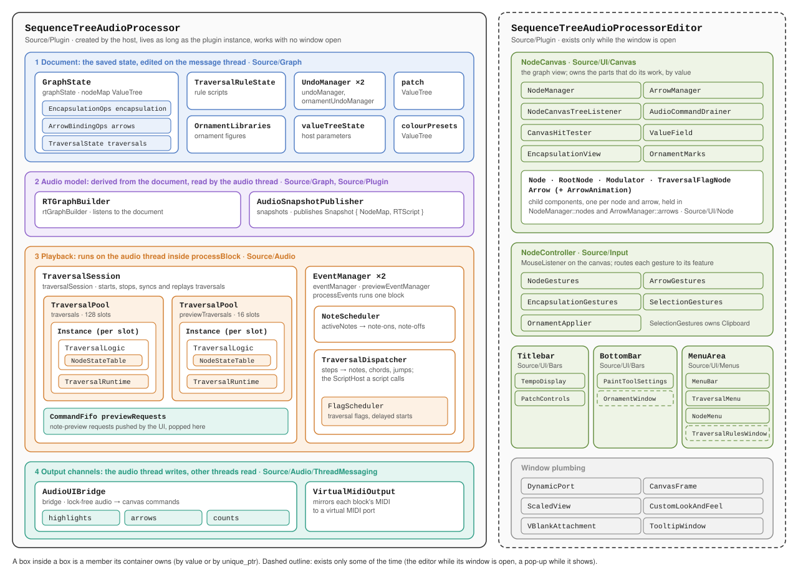
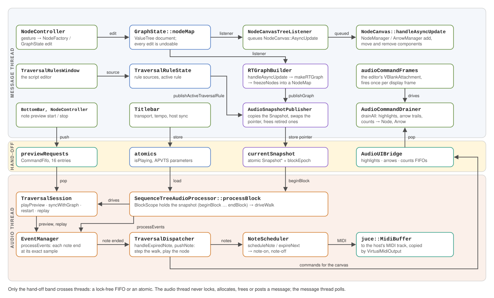

# SequenceTree architecture

This is the technical companion to the [README](../README.md). It goes through the program from the top down. First come the two objects everything hangs from, then the layers inside each, then the classes inside each layer. The last sections cover how the parts talk across threads and which folders may depend on which. Build commands and contributor notes are in the [development guide](Development.md), and the language is in the [scripting guide](ScriptingLanguage.md).

## 1. The two roots

Every object in the program is owned, directly or through a chain of members, by one of two classes in `Source/Plugin/`:

| Root | Created by | Lifetime | Owns |
|---|---|---|---|
| `SequenceTreeAudioProcessor` | the host (or the standalone wrapper) | the whole plugin instance | everything the sound depends on: the document, the audio model, playback and the output channels |
| `SequenceTreeAudioProcessorEditor` | `SequenceTreeAudioProcessor::createEditor` | only while the window is open | views and input: the canvas, the gesture router, the bars and menus |

*Figure 1. What owns what. A box inside a box is a member its container owns.*

The split follows lifetime. Closing the window destroys the editor and nothing else, so the processor must hold whatever playback, saving and undo need. This is why `undoManager` and `RTGraphBuilder` are processor members even though only the UI edits the graph: undo history survives a closed window, and an edit (a restored state, for example) still reaches the audio with no editor open.

References run from the editor into the processor and almost never back. The editor hands each component the processor members it uses, by reference, through its constructor (see *How components get what they need* in the development guide). The processor reaches the editor in one place only: `applyRestoredState` asks the active editor's `nodeCanvas` to `rebuildFromNodeMap` after a state load.

## 2. The processor

`SequenceTreeAudioProcessor`'s members fall into four layers. Each layer reads the one above it and is read by the one below it.

| Layer | Members | Folder | Thread |
|---|---|---|---|
| 1. Document | `graphState`, `traversalRuleState`, `ornamentLibraries`, `undoManager`, `ornamentUndoManager`, `valueTreeState`, `patch`, `colourPresets` | `Source/Graph/` | message |
| 2. Audio model | `rtGraphBuilder`, `snapshots` (`AudioSnapshotPublisher`) | `Source/Graph/`, `Source/Plugin/` | built on message, read on audio |
| 3. Playback | `traversalSession`, `eventManager`, `previewEventManager` | `Source/Audio/` | audio |
| 4. Output channels | `bridge` (`AudioUIBridge`), `virtualMidiOutput` | `Source/Audio/ThreadMessaging/` | written on audio, read elsewhere |

### 2.1 Document

The document is the state that is saved. All of it is `juce::ValueTree` data, edited on the message thread through undoable transactions.

- **`GraphState`** owns `nodeMap`, the graph: one child tree per node with its position, limits, MIDI notes, and the list of arrows to its children. Every edit to the graph goes through `GraphState` or one of the three parts it owns, which callers reach as members (`graphState.encapsulation.dissolve(...)`):
  - `EncapsulationOps encapsulation`: group membership.
  - `ArrowBindingOps arrows`: arrow settings and pitch bindings.
  - `TraversalState traversals`: the traversal map.

  `GraphState` also listens to its own `nodeMap` to keep an id index (`getNode`, `getNodeParent`, `parentIdsOf`), so undo, redo and paste keep the index current without any extra code.
- **`TraversalRuleState`** holds the traversal-rule scripts and which one is active. It is a separate document from the graph and shares only the save file.
- **`OrnamentLibraries`** holds the ornament figures.
- **`valueTreeState`** (`AudioProcessorValueTreeState`) holds the host-automatable parameters: tempo multiplier, velocity, transpose and host sync.

Two classes outside the processor write the document. `NodeFactory` is a set of static functions that build new nodes and arrows out of `GraphState` calls and apply the creation defaults. `Clipboard`, owned by `SelectionGestures`, copies and pastes nodes. Neither renders anything. The canvas only reacts to the trees they write.

### 2.2 Audio model

The audio thread cannot read a `ValueTree`. This layer turns the document into plain structs (`RTData.h`: `RTNode`, `RTConnection`, `NodeMap`) and the script source into bytecode (`RTScript`), then publishes both.

- **`RTGraphBuilder`** is a `ValueTree::Listener` on `nodeMap`, the traversal map and the ornament libraries. It collects what each change touched into `PendingChanges`. Its `handleAsyncUpdate` rebuilds each affected tree with `makeRTGraph` (or `discardGraph` for a deleted root), freezes it into a sorted `NodeMap` (`freezeNodes`) and hands it to the publisher. Arrow durations are computed here from arrow geometry (`fillDurationMap`). It reads the document and never writes to it.
- **`AudioSnapshotPublisher`** owns everything the audio thread reads: one immutable `Snapshot { globalNodes, traversalScript, generation }` behind an atomic pointer. Every change copies the current snapshot (`beginEdit`), replaces one member and calls `publish`. `publishGraph` merges a rebuilt tree into the nodes. `publishScript` and `publishActiveTraversalRule` publish a compiled rule. Old snapshots are freed only once `blockEpoch` shows that no block can still be reading them (see 2.3).
- **The script compiler** (`Source/Script/`) makes the bytecode. `compileTraversalScript` runs `ScriptLexer` → `ScriptParser` → `ScriptEmitter` on the message thread. It returns an `RTScript` or a `ScriptDiagnostic` with a line and column. Each phase is a local that lives for one compile. Only the `RTScript` ever reaches the audio thread.

### 2.3 Playback

Playback runs entirely inside `processBlock` on the audio thread. Three levels of classes do the work:

1. **`TraversalSession`** decides which traversals exist. It starts them from roots, removes those whose root or assignment was deleted (`syncWithGraph`), restarts them, and replays the walk silently after a host relocation (`beginReplay` / `continueReplay`). It owns:
   - `TraversalPool traversals` (128 slots) and `TraversalPool previewTraversals` (16 slots). Each slot holds an `Instance { TraversalLogic logic; TraversalRuntime runtime; }`, allocated in `prepare` so that starting a traversal never allocates.
   - `CommandFifo previewRequests`, through which the UI asks for note preview.
2. **`TraversalLogic`** (`Source/Audio/Traversal/`) is one walk. It holds the node it is on and its counts, kept in a `NodeStateTable`, and on each `handleNodeEvent` it picks the next node through the active `TraversalRule`, or through the script when one is set (run by `ScriptRun`). It returns a `StepResult` and produces no MIDI. This folder uses no JUCE, which is what lets `SequenceTree_Tests` compile it on its own.
3. **`EventManager`** (one for playback, one for preview) moves time forward. `processEvents` finds each note ending inside the block and handles it at its exact sample. It owns:
   - `NoteScheduler`: the sounding notes (`activeNotes`), note-ons on `scheduleNote` and note-offs on `expireNext`.
   - `TraversalDispatcher`: turns a step into output. `handleExpiredNote` steps the `TraversalLogic`, and `pushNote` plays the node it entered, with its chord, modulator, cross-tree jumps and traversal flags, and pushes canvas commands into the bridge. It owns `FlagScheduler`, which fires traversal flags and holds delayed traversal starts.

One block, in order:

1. `BlockScope` calls `snapshots.beginBlock()`, which makes `blockEpoch` odd and loads the current `Snapshot*`. Its destructor calls `endBlock()`.
2. `followHostTransport` reads the host's play state, tempo and position.
3. Notes are silenced or suspended on stop or reset, and `traversalSession.setTraversalScript` installs the snapshot's script.
4. `driveWalk` builds a `DispatchContext` (nodes, pool, `MidiBuffer`, tempo, transpose, velocity) for playback and one for preview. It then runs `playPreview`, replays to a new position if the host jumped, calls `syncWithGraph`, starts a walk from the first root if none is running, and calls `eventManager.processEvents`.
5. `virtualMidiOutput.mirrorBlock` copies the block's MIDI out.

### 2.4 Output channels

- **The `MidiBuffer`** goes back to the host. The plugin declares itself a synth that only sends MIDI, and its audio buffer is always cleared.
- **`VirtualMidiOutput`** copies each block's MIDI into a `CommandFifo`. A timer sends those messages to a virtual MIDI port, so other apps can receive them.
- **`AudioUIBridge`** is the only channel from audio to screen: three `CommandFifo`s (`highlights`, `arrows`, `counts`) of plain command structs. During a replay its `delivery` is `Record`, so commands fold into fixed tables instead and `deliverRecording` sends the net state when the replay ends.

## 3. The editor

`SequenceTreeAudioProcessorEditor` builds its children in its constructor, the canvas first and the controller second, because the bars take both:

| Member | Folder | Job |
|---|---|---|
| `nodeCanvas` (`NodeCanvas`) | `Source/UI/Canvas/` | draws the graph and applies changes to it |
| `nodeController` (`NodeController`) | `Source/Input/` | receives every mouse event on the canvas and routes it |
| `titleBar` (`Titlebar`) | `Source/UI/Bars/` | transport, tempo, display mode, undo / redo, patches |
| `bottomBar` (`BottomBar`) | `Source/UI/Bars/` | canvas tools, arrow bindings, note preview, ornament window |
| `menuArea` (`MenuArea`) | `Source/UI/Menus/` | the `MenuBar` plus the `TraversalMenu` and `NodeMenu` panels |
| `port`, `canvasFrame`, `scaledView`, `lookAndFeel`, `tooltipWindow`, `audioCommandFrames` | ArsNovaUI, JUCE, `Source/UI/Canvas/` | zoom and pan, framing, interface scale, theme, tooltips, the per-frame poll |

### 3.1 `NodeCanvas`

The canvas is a component that owns, by value, the parts that do its work:

- `NodeManager` creates, positions and removes `Node` components and keeps them in `nodes`. `Node` has three subclasses: `RootNode`, `Modulator` and `TraversalFlagNode`.
- `ArrowManager` does the same for `Arrow` components, kept in `arrows`.
- `NodeCanvasTreeListener` turns `nodeMap` changes into `AsyncUpdate` records on the canvas's queue.
- `AudioCommandDrainer` empties the bridge's FIFOs into node highlights, arrow trails and counts.
- `CanvasHitTester` answers picking queries. `ValueField` draws paint mode. `EncapsulationView` and `OrnamentMarks` draw groups and ornament marks.

`handleAsyncUpdate` is the canvas's one entry point for change. It applies the queued tree updates and calls `drainer.drainAll()`. The canvas also holds what is shared across tools: the snap grid and `activeTool`, which only `setActiveTool` changes.

### 3.2 `NodeController`

`NodeController` is a `MouseListener` on the canvas that routes events. It does no editing itself. On `mouseDown` it decides which feature the gesture belongs to: the active canvas tool first, then the arrow hit tests, then the node or the empty canvas. It records the owner in its `Gesture` enum, so `mouseDrag` and `mouseUp` go to the same place. Each feature is a class it owns:

- `NodeGestures`: root creation, moving nodes, drag-to-create a child.
- `ArrowGestures`: drawing, moving and connecting arrows, and the arrow context menu.
- `EncapsulationGestures`: the span tool, and expanding or collapsing groups.
- `SelectionGestures`: box selection, copy, delete and paste (owns the `Clipboard`).
- `OrnamentApplier`: applying and removing ornaments.

A new canvas feature becomes one more class here and one more branch in the routing.

### 3.3 Bars and menus

`Titlebar`, `BottomBar`, `MenuBar` and the menu panels derive from ArsNovaUI's `Bar` and are built from its generic components (`ButtonPane`, `IconButton`, `ItemSelector`, `ValueSlider`, `LabeledEditor`). Two windows open as pop-ups and exist only while shown:

- `TraversalRulesWindow`, the script editor, opened from `TraversalMenu` or `NodeMenu`.
- `OrnamentWindow`, opened from `BottomBar`.

### 3.4 ArsNovaUI

The theme (`Theme`, `CustomLookAndFeel`), the zoom and pan viewport (`DynamicPort`), `ScaledView`, `Bar` and the generic components come from the [ArsNovaUI](https://github.com/EliBaumgardner/ArsNovaUI) submodule, in `namespace ArsNovaUI`. The editor sets the look-and-feel on itself and JUCE passes it down to every child. Only pop-up roots, the canvas, and components that read the theme in their constructor take it explicitly.

## 4. How the parts talk

The two threads never call into each other. Each crossing goes through a lock-free FIFO or an atomic, shown as the middle band in figure 2.

*Figure 2. The paths between the message thread and the audio thread.*

1. **Edit → screen** (message thread only). A gesture class edits `GraphState`, usually through `NodeFactory`, inside an undo transaction. `NodeCanvasTreeListener` queues an `AsyncUpdate`, and `NodeCanvas::handleAsyncUpdate` has `NodeManager` and `ArrowManager` add, move or remove components. Undo and redo take the same path, because the listener reacts to the tree, not to the gesture.
2. **Edit → sound.** The same tree change reaches `RTGraphBuilder`'s listener. Its `handleAsyncUpdate` rebuilds the touched trees, and `AudioSnapshotPublisher::publishGraph` stores a new `Snapshot*`. The next block's `beginBlock` loads it.
3. **Script → sound.** `TraversalRulesWindow` writes the source into `TraversalRuleState` and, after a 250 ms debounce, calls `publishActiveTraversalRule`. That compiles the source and publishes the `RTScript` the same way. A failed compile returns diagnostics to the editor, and the last good script keeps playing.
4. **Sound → screen.** `TraversalDispatcher` pushes highlight, arrow and count commands into `AudioUIBridge`. The editor's `audioCommandFrames` (a `VBlankAttachment`) fires once per display frame, applies transport changes to the `Titlebar` and calls `NodeCanvas::handleAsyncUpdate`, which drains the FIFOs. With no editor open the FIFOs overflow, and the drainer resyncs the canvas on its first drain.
5. **Controls → sound.** The `Titlebar`'s transport buttons store the atomics `isPlaying` (through `NodeCanvas::setProcessorPlayback`) and `resetRequested`. Its tempo and sync controls set host parameters. `processBlock` loads all of them each block. Note preview requests from `BottomBar`, `NodeController` and `NodeCanvas` go through `previewRequests`, which `TraversalSession::playPreview` pops.

Memory is reclaimed without the audio thread freeing anything. `blockEpoch` is odd while a block runs. When `publish` replaces a snapshot it reads the epoch: if it is even, the old snapshot is freed on the spot; if it is odd, the snapshot is parked in `retiredSnapshots` until the epoch moves on. The audio thread therefore never drops the last reference. A RealtimeSanitizer build enforces this (section 6).

## 5. Folders and dependency direction

| Folder | Layer | Includes from |
|---|---|---|
| `Source/Util/` | value types (`NodeInfo`, `ArrowInfo`) | nothing |
| `Source/Script/` | compiler, `RTScript` | nothing (no JUCE) |
| `Source/Audio/Traversal/` | one walk and its state | `Graph/RTData.h`, `Script/RTScript.h` (no JUCE) |
| `Source/Audio/` | playback and channels | `Graph`, `Script`, `Util` |
| `Source/Graph/` | document and audio-model builder | `Util`, `Script` |
| `Source/Input/` | gesture routing and features | `Graph`, `UI`, `Util` |
| `Source/UI/` | components | `Graph`, `Audio`, `Input`, `Util`, `Script` |
| `Source/Plugin/` | the two roots and the publisher | everything |

The lower rows depend on the upper ones. The exceptions are `.cpp` files that include `Source/Plugin/` headers to reach processor members: `RTGraphBuilder.cpp`, `NodeController.cpp`, `NodeCanvas.cpp`, `Titlebar.cpp` and `PatchControls.cpp` include `PluginProcessor.h`, and `TraversalRulesWindow.cpp` includes `AudioSnapshotPublisher.h`.

## 6. Tests

Unit tests, which check the traversal core and the script compiler on their own, are in `Tests/Unit/`. Integration tests, which build graphs through the plugin's shared code or play them through `processBlock`, are in `Tests/Integration/`.

| Target | Files | What it covers |
|---|---|---|
| `SequenceTree_Tests` | `TraversalTests`, `ScriptCompilerTests` | `Source/Audio/Traversal/` and `Source/Script/`, compiled without JUCE. Includes walk parity (a node tree and the same shape built as modulators unfold the same sequence), compiler diagnostics, the step budget, and the default script matching the native rule. |
| `SequenceTree_GraphTests` | `GraphTests`, `OrnamentTests` | Graphs built through `NodeFactory` and `GraphState`, read back from what `RTGraphBuilder` published: arrow length → duration, chords, pitch bindings, creation defaults, ornaments. |
| `SequenceTree_RealtimeTests` | `RealtimeTests` | Plays a graph through a fake host while editing, relocating and stopping, with `-fsanitize=realtime`, so any allocation, lock or blocking call in `processBlock` aborts. Built only with `SEQUENCETREE_REALTIME_SANITIZER`. |

Build and run commands are in the [development guide](Development.md#tests). MIDI timing against a real host, the UI, and plugin-format behaviour are checked by hand in a DAW.
